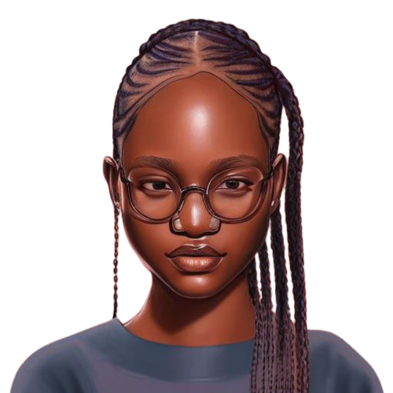

<h1 align="center">
  Hola , I'm Meekun!
</h1>

<h3 align="center">
  Software Engineer | AI & Computer Vision Master's Student
</h3>

  Building thoughtful digital experiences and exploring how machines learn to see the world. 💜

  
  
  

---

## 🧐 A Little About Me

I'm **Adedamola (Meekun)**, a Software Engineer with a background in frontend development and a growing passion for **Artificial Intelligence and Computer Vision**.

🎓 I'm currently pursuing an **Erasmus Mundus Joint Master's in Artificial Intelligence for Image Processing and Computer Vision (IPCVai)**, studying across **Hungary, Spain, and France**.

💻 I have professional experience building web applications and cloud developer tools using **React, Vue.js, and TypeScript**.

🔬 My research interests include:
- Computer Vision & Deep Learning
- Representation Learning & Model Generalization
- Continual Learning
- Human-Computer Interaction & Emotion-Aware AI

🧠 I'm particularly interested in how Computer Vision can help machines better interpret human expressions and behaviors, enabling more responsive and human-centered technologies.

🌱 Currently exploring **continual learning**, deep learning techniques, and practical Computer Vision applications.

👩🏽‍💻 Check out my projects: [My Portfolio](https://adedamolaorofin.vercel.app/)

📫 Reach me at **orofinadedamola@gmail.com**

✨ Open to **AI/Computer Vision internships, research collaborations, and software engineering opportunities**.

 

---

## 🛠️ Languages & Technologies

### 🤖 AI, Machine Learning & Computer Vision

  

`Deep Learning` · `Computer Vision` · `YOLO` · `CNNs` · `Vision Transformers` · `Image Processing` 

### 💻 Frontend Development

  

### ⚙️ Backend & Development Tools

  

---

## 🚀 Featured Projects

### 👁️ Real-Time Facial Recognition Attendance System
A face detection and recognition system for automated attendance tracking.

**Tech:** YOLOv10-N · FaceNet512 · React · Flask · MySQL

### 🧬 Medical Image Classification & Interpretability
Exploring CNNs, ResNet18, and Vision Transformers for medical image classification, with Grad-CAM and attention-based interpretability.

**Tech:** PyTorch · ResNet18 · ViT · PathMNIST

### 📦 Expiration Date Detection & Recognition
An ongoing Computer Vision project exploring object detection and OCR for recognizing expiration dates on product packaging.

**Tech:** YOLO · OCR · Python

### 🖼️ PCA-Based Spectral Image Analysis
Exploring dimensionality reduction and reconstruction of hyperspectral and natural images using Principal Component Analysis.

**Tech:** Python · PCA · Scikit-learn · NumPy

  <a href="https://adedamolaorofin.vercel.app/">
    🔗 Explore more projects on my portfolio
  </a>

---

## 🌍 Beyond the Code

- 🗣️ Learning **Spanish and French**.
- 🎲 I enjoy Scrabble, board games, and iMessage games.
- 🎮 Occasionally playing **Call of Duty: Mobile**.
- 🌎 Exploring new cultures, meeting people, and stepping outside my comfort zone.
- 💜 I love discovering random facts and learning new things.
- 👀 And yes, I still have a thing for emojis!

---

## 📊 GitHub Activity

  <picture>
    <source media="(prefers-color-scheme: dark)" srcset="https://streak-stats.demolab.com?user=Meekunn&theme=dark" />
    
  </picture>

---

  <i>Always learning, experimenting, and building. 💜</i>

